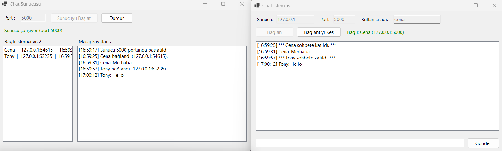
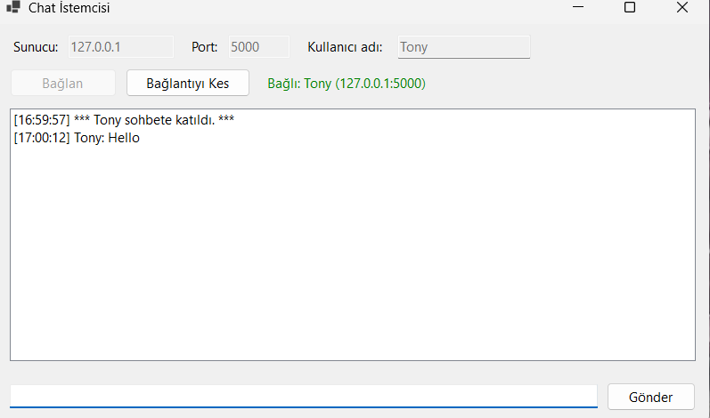

# YMH219-ChatApp — İstemci-Sunucu Chat Uygulaması

Nesne Tabanlı Programlama (YMH 219) dersi için C# ve Windows Forms ile geliştirilmiş, TCP/IP üzerinden çalışan basit bir sohbet uygulaması.

Çözüm iki ayrı programdan oluşur:

- **ChatServer:** Belirlenen portu dinler, bağlanan istemcileri listeler ve gelen her mesajı bağlı bütün istemcilere iletir.
- **ChatClient:** Kullanıcı adıyla sunucuya bağlanır, mesaj gönderir ve diğer kullanıcıların mesajlarını zaman bilgisiyle gösterir.

İki program aynı bilgisayarda (`127.0.0.1`) veya aynı yerel ağda çalışabilir.

## Ekran Görüntüleri

**Sunucu ve iki istemci aynı anda**



**İkinci istemci**



## Kullanılan Teknolojiler

- C# / .NET 10 (`net10.0-windows`)
- Windows Forms
- `TcpListener`, `TcpClient`, `NetworkStream`
- `StreamReader` / `StreamWriter` (UTF-8, satır tabanlı iletişim)
- `async` / `await` ile arayüzü dondurmayan ağ işlemleri
- Harici NuGet paketi kullanılmamıştır

## Kurulum ve Çalıştırma

1. Depoyu klonlayın:
   ```
   git clone https://github.com/cenaismail/YMH219-ChatApp.git
   ```
2. `ChatServer/YMH219-ChatApp.slnx` dosyasını Visual Studio ile açın (.NET 10 SDK gereklidir).
3. **F5** ile çalıştırın. Çözüm, sunucu ve istemci birlikte açılacak şekilde ayarlanmıştır.
4. Sunucu penceresinde **Sunucuyu Başlat**'a basın (varsayılan port: 5000).
5. İstemci penceresinde kullanıcı adı girip **Bağlan**'a basın.
6. Ek istemci açmak için: Çözüm Gezgini'nde **ChatClient** → sağ tık → **Hata Ayıkla → Yeni Örnek Başlat**.

Windows Güvenlik Duvarı izin isterse **İzin ver** seçilmelidir. Farklı bir bilgisayardan bağlanmak için istemcide sunucu adresi olarak sunucu bilgisayarın yerel IP adresi yazılır.

## Temel Özellikler

**Sunucu**
- Port seçerek başlatma / durdurma
- Bağlı istemcilerin listesi: kullanıcı adı, IP:port ve bağlanma saati
- Bağlanma, ayrılma ve tüm mesajların zaman damgalı kaydı
- Gelen mesajı bütün istemcilere iletme; katılma/ayrılma bildirimleri
- Port kullanımdaysa veya geçersizse hata mesajı

**İstemci**
- Sunucu adresi, port ve kullanıcı adıyla bağlanma
- **Bağlan**, **Mesaj Gönder** (buton veya Enter) ve **Bağlantıyı Kes** işlevleri
- Gönderilen ve alınan mesajlar saat bilgisiyle gösterilir
- Bağlantı durumu renkli yazıyla gösterilir; bağlı değilken mesaj alanı kapalıdır
- Sunucuya ulaşılamazsa veya bağlantı koparsa uygulama kapanmaz, kullanıcı bilgilendirilir

## İletişim Biçimi (Protokol)

Her mesaj tek bir metin satırıdır; alanlar `|` ile ayrılır.

| Yön | Satır | Anlamı |
|---|---|---|
| İstemci → Sunucu | `JOIN\|Cena` | Kullanıcı adıyla katılma |
| İstemci → Sunucu | `MSG\|Merhaba` | Sohbet mesajı |
| Sunucu → İstemci | `MSG\|16:59:31\|Cena\|Merhaba` | Bir kullanıcının mesajı |
| Sunucu → İstemci | `SYS\|16:59:57\|Tony sohbete katıldı.` | Sistem bildirimi |

Mesaj metni en fazla 4 parçaya bölünerek ayrıştırılır; böylece mesajın içinde `|` karakteri olsa bile bozulmaz.

## Proje Yapısı ve Sınıflar

```
ChatServer/
├── ChatServerHost.cs     Sunucu mantığı: dinleme, istemci listesi, mesajı herkese iletme
├── ClientConnection.cs   Bağlı tek bir istemci: kullanıcı adı, adres, bağlanma zamanı, gönderme
└── Form1.cs              Sunucu arayüzü

ChatClient/
├── ChatConnection.cs     İstemci bağlantısı: bağlanma, gönderme, gelen mesajları dinleme
└── Form1.cs              İstemci arayüzü
```

**Tasarım notları**

- Ağ işlemleri (`ChatServerHost`, `ChatConnection`) arayüzden ayrı sınıflardadır. Formlar bu sınıfların olaylarını (`Log`, `ClientsChanged`, `MessageReceived`, `Disconnected`) dinleyerek ekranı günceller.
- Tüm ağ işlemleri `async`/`await` ile yapılır; arayüz bağlantı beklerken veya mesaj okurken donmaz.
- Bağlantı hataları (`SocketException`, `IOException`, `ObjectDisposedException`) yakalanır ve kullanıcıya bildirilir.
- Aynı istemciye aynı anda iki mesaj yazılmasını önlemek için `SemaphoreSlim` kullanılır.

## Bilinen Sınırlamalar / Geliştirme Notları

- Tek bir ortak sohbet odası vardır; özel mesaj ve birden fazla oda desteği yoktur.
- Aynı kullanıcı adıyla birden fazla istemci bağlanabilir.
- Mesaj geçmişi dosyaya kaydedilmez.
- İletişim şifrelenmez; yalnızca yerel ağda ders amaçlı kullanım içindir.

## Öğrenci

- **Ad Soyad:** Cena İsmail
- **Öğrenci No:** 250541615
